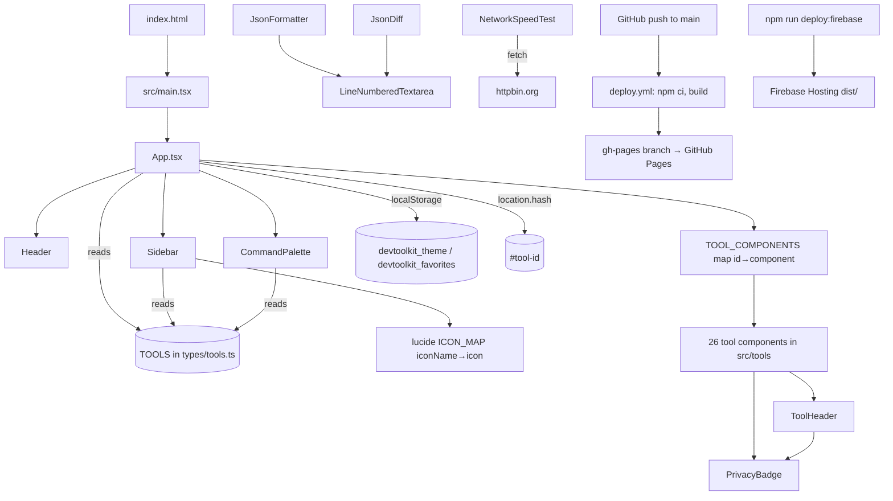

# DevToolkit Studio – Knowledge Graph

Generated from a read of the whole `src/` tree (6.7k lines, 27 tools). Machine-readable version: [knowledge-graph.json](knowledge-graph.json).

## 1. System / module graph

## 2. State & data flow
| State | Owner | Storage | Notes |
|---|---|---|---|
| theme (`dark`/`light`) | App | `localStorage devtoolkit_theme`, `dark` class on `<html>` | default dark |
| favorites (string[]) | App | `localStorage devtoolkit_favorites` | default: epoch, csv-editor, jwt, json-formatter |
| activeToolId | App | `location.hash` | deep-linkable, fallback `epoch-converter` |
| palette open | App | memory | Cmd/Ctrl+K toggles |
| tool inputs/outputs | each tool | memory only | nothing persisted or sent |

## 3. Tools → category → third-party dependency
| Category (UI) | Tool id | Library / API |
|---|---|---|
| Time & Formatters | epoch-converter, world-clock-tool | `Intl` / Date |
| | csv-editor-tool | FileReader, Blob download |
| | base64-converter, html-entity-converter, php-serializer, curl-converter | none (hand-written) |
| | yaml-converter | `yaml` |
| | sql-formatter | `sql-formatter` |
| Tokens & Security | jwt-decoder | `crypto-js` (HMAC verify) |
| | hash-generator | `crypto-js` |
| | password-generator | Web Crypto |
| JSON Utilities | json-formatter | `LineNumberedTextarea` |
| | json-viewer, es-query-generator | none |
| | swagger-editor | `yaml` (parse + YAML⇄JSON), own validator/preview |
| | json-diff | `LineNumberedTextarea` |
| Diffs & Text | file-text-diff | `diff` |
| | string-escape, regex-tester, string-converter | none |
| Generators & Web | network-speed-test | `fetch` → httpbin.org |
| | html-preview | sandboxed iframe |
| | url-encoder, uuid-generator, color-converter | `URL` / Web Crypto / none |
| | cron-parser | `cron-parser` (`CronExpressionParser`) + `cronstrue` |

Unused dependency: `jwt-decode`.

## 4. File map
- `src/App.tsx` – shell, state, registry map
- `src/types/tools.ts` – `ToolCategory`, `ToolDefinition`, `TOOLS`
- `src/components/` – Header (theme toggle, palette button, mobile menu), Sidebar (filter, favorites, categories), CommandPalette, ToolHeader, PrivacyBadge, LineNumberedTextarea
- `src/tools/` – one file per tool (largest: EsQueryGenerator 470, CsvEditorTool 429, NetworkSpeedTest 406, WorldClockTool 404)
- Config: `vite.config.ts` (base `./`), `tailwind.config.js` (class dark mode, `brand`/`dark` colours), `tsconfig*.json` (strict), `.github/workflows/deploy.yml`

## 5. Recent history (git)
CSV editor → network speed test → multi-timezone cron → cron-parser integration fix → world clock. Pattern: one feature commit per tool, `feat:`/`fix:` prefixes.
